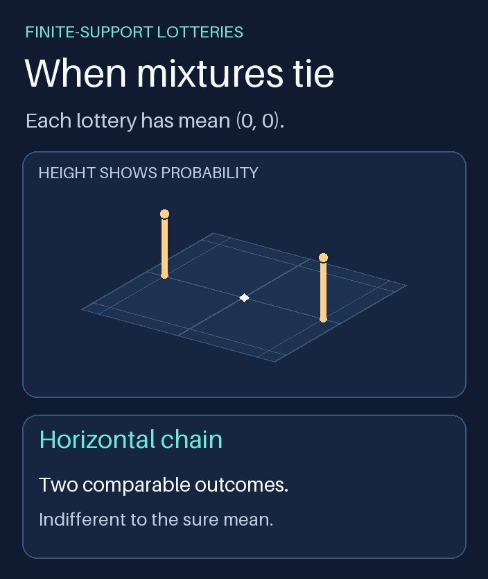

# Indifferent independence for finite-support lotteries

  

Indifferent Independence is compatible with Good Expectations, Negative Dominance and positive-mass Stochastic Dominance on finite-support lotteries over product-ordered real vectors. The preorder closes identifications of same-mean good lotteries under mixtures and combines them with stochastic dominance.

[Read the paper](paper/manuscript.pdf) · [LaTeX source](paper/manuscript.tex) · [Proof outline](proof/PROBLEM_AND_PROOF.md) · [Run the replay](REPRODUCIBILITY.md)

## When mixtures tie

In Lederman’s example the horizontal and vertical lotteries each have two comparable outcomes. Their equal mixture has four outcomes but stays in the same indifference class as the sure mean. The two-point antidiagonal lottery also has mean zero and remains incomparable with that sure outcome.

[Download the offline explorer](https://raw.githubusercontent.com/DannyExperiments/indifferent-independence-lotteries/refs/tags/v1.0.0/visualization/lottery-mixtures-explorer.zip), extract it, and open `index.html`. Change the mixture share and rotate the plot. [Figure guide](visualization/README.md)

## Source and scope

The construction extends Lederman’s Proposition 3.1 by taking convex hulls within each mean class, then checking strict support witnesses in the transitive closure. The theorem uses the positive-mass strict coupling condition in the pinned catalog. Lederman’s generalized lottery definition allows zero weights; those matched atoms are deleted before checking strictness.

[Original question](https://arxiv.org/pdf/2311.08471v1#page=26) · [Pinned Q1089](https://github.com/10m-u/open-problems-catalog/blob/ca8d4d44ba3db527f19f28928c240168f545ecfe/problems/mathematics/optimization-operations-research.md#q1089)

[Mathematical audit](audits/public_safe_reports/MATHEMATICAL_AUDIT.md) · [Literature audit](audits/public_safe_reports/LITERATURE_AUDIT.md) · [Scope](CLAIM_SCOPE_AND_LIMITATIONS.md) · [AI disclosure](AI_DISCLOSURE.md) · [Status](STATUS.md)

[Release v1.0.0](https://github.com/DannyExperiments/indifferent-independence-lotteries/releases/tag/v1.0.0) · [Version DOI](https://doi.org/10.5281/zenodo.24572917) · [Citation](CITATION.cff)
